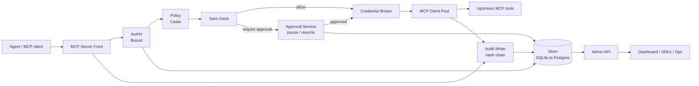
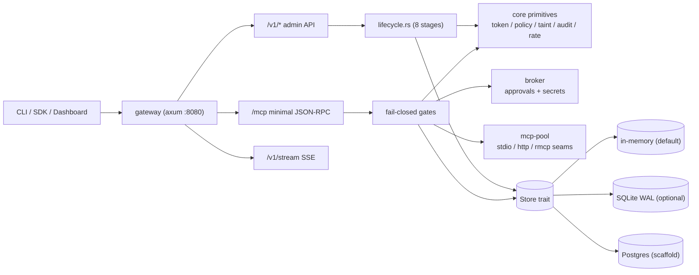

# ScopeGate (S1 preview)

Least-privilege MCP gateway for AI agents (Rust workspace). **Preview, not production-ready; no security/release sign-off.**

> **Verification (current source, 2026-11-21):** `cargo fmt --all --check`, `cargo clippy --all-targets -- -D warnings`, and `cargo test --all` **green**. Bench: **38 passed, 7 xfailed** unconfigured; configured clean-gateway sqlite+stdio capture **45 passed, 0 xfailed** (`phase3a-t6-live-bench-20261121T170500Z`, evidence only). Dashboard `npm run build` and SDK checks (`py_compile`, `tsc --noEmit`) **green**. Not sign-off.
>
> **CLI (2026-11-26):** `crates/cli` adds `scopegatectl` (one-shot commands + ratatui TUI); `cargo test -p scopegate-ctl` **13 passed** (including a render assertion), `cargo fmt --all --check` and `cargo clippy --all-targets -- -D warnings` **green**. Smoke-tested against the local sqlite demo gateway. Preview client, not a sign-off surface.
>
> **Captured sqlite+stdio S1 proof:** [`e2e/logs/proof-s1-source-20261120T194149Z/`](e2e/logs/proof-s1-source-20261120T194149Z/) (`sqlite_wal`, stdio upstream demo; manifest `scopegate.e2e_evidence_manifest.v1`, commit `2e16912`). Shows managed runtime/API flow evidence including MCP allow, deny (fail-closed), approval pending-deny → approved-allow, and `/v1/audit/verify` (`ok:true`, `checked_events:14` in captured probe). Not S1/S2 validation or sign-off.
>
> **Captured sqlite+stdio restart evidence:** [`e2e/logs/proof-s1-source-restart-20261120T201236Z/`](e2e/logs/proof-s1-source-restart-20261120T201236Z/) (same sqlite_wal DB/config): pre-restart S1 flow + post-restart audit verify/continuity and task-state continuity captured. [`e2e/logs/smoke-scripts-restart-evidence/`](e2e/logs/smoke-scripts-restart-evidence/) provides additional two-phase restart smoke. Runtime endpoint evidence only; **not** full restart/durability/prod proof.
>
> **Evidence index:** [`e2e/FINAL_S1_EVIDENCE.md`](e2e/FINAL_S1_EVIDENCE.md).

## Architecture at a glance

**Target design** — least privilege enforced at the MCP tool boundary (`docs/architecture.md:7-24`):



**Current implementation** — partial wiring; the diagram shows what is actually reachable today (`docs/architecture.md:11-20`):



**Target request lifecycle** — audit is appended before the result returns (`docs/architecture.md:83-95`); that guarantee is not proven end-to-end across all runtime paths (`docs/STATUS.md:30-35`):

```mermaid
sequenceDiagram
    participant Agent
    participant GW as gateway /mcp
    participant Core as core primitives
    participant Broker
    participant Store
    participant Upstream as upstream MCP tool
    Agent->>GW: tools/call + task token
    GW->>Core: verify token, rate/budget, taint, policy
    Core-->>GW: allow / require approval / deny
    alt require approval
        GW->>Broker: pause; wait for resolution
        Broker-->>GW: approved / denied / timeout (= deny)
    end
    GW->>Broker: inject secret; scrub agent-visible result
    GW->>Upstream: forward via pool
    Upstream-->>GW: result
    GW->>Store: append hash-chained audit (before return)
    Store-->>GW: persisted
    GW-->>Agent: redacted result
    Note over GW,Store: Fail-closed intent; durable append-before-return and crypto audit are not proven end-to-end.
```

## Quickstart (local S1-style preview)

**Prereqs:** Rust toolchain (`rust-toolchain.toml`), Python 3, Node/npm, optional `curl`.

```bash
# 1) Baseline checks
cargo fmt --all --check
cargo clippy --all-targets -- -D warnings
cargo test --all
python3 -m pytest bench -q              # 38 passed, 7 xfailed unconfigured; 45 passed, 0 xfailed on configured clean-gateway capture
python3 -m py_compile sdk/python/src/scopegate_sdk/__init__.py
cd dashboard && npm ci && npm run build && cd ..

# 2) Run HTTP gateway with SQLite (preview)
./scripts/run_sqlite_demo.sh
# or: cargo build -p gateway && GATEWAY_STORE_BACKEND=sqlite_wal SCOPEGATE_DATABASE_URL=sqlite:///./.scopegate/scopegate.db cargo run -p gateway

# 3) Basic probes (separate shell)
curl -s http://127.0.0.1:8080/healthz
curl -s http://127.0.0.1:8080/readyz
curl -s http://127.0.0.1:8080/metrics | head

# 4) MCP stdio mode (preview)
# GATEWAY_CONFIG=./scopegate.toml.example cargo run -p gateway -- --stdio
```

Config/examples: `scopegate.toml.example`, `policies/examples/`. Dashboard: `VITE_API_BASE_URL=http://127.0.0.1:8080` (`dashboard/.env.example`), `npm run dev` (live API/SSE with fallback). SDKs: `sdk/python`, `sdk/ts` (preview HTTP/MCP clients).

## Operator CLI — `scopegatectl`

A small client for a running gateway (`crates/cli/`). It talks only to the documented v1 HTTP API and links no gateway internals, so it cannot bypass a fail-closed check. Full usage: [`crates/cli/README.md`](crates/cli/README.md).

```bash
cargo build -p scopegate-ctl
./target/debug/scopegatectl status
./target/debug/scopegatectl tasks
./target/debug/scopegatectl approvals list --status pending
./target/debug/scopegatectl approvals resolve <id> approve   # or deny / timeout
./target/debug/scopegatectl audit list --limit 10
./target/debug/scopegatectl audit verify
./target/debug/scopegatectl policies
./target/debug/scopegatectl tui
```

Global options: `--url` / `SCOPEGATE_URL` (default `http://127.0.0.1:8080`) and `--token` / `SCOPEGATE_TOKEN`.

`scopegatectl tui` is a btop/abtop-style full-screen dashboard: live header, readiness and audit-chain gauges, traffic sparklines from the gateway's Prometheus counters, colour-coded tables, and three themes. Keys: `Tab`/`←→` switch views, `j`/`k`/`↑↓` select, `r` refresh, `a`/`d`/`x` resolve the selected approval, `t` cycle theme, `q` quit. It requires an interactive terminal; the one-shot commands work anywhere.

The only state the CLI changes is an approval resolution through `POST /v1/approvals/:id/resolve`. Treat its output as preview tooling against a preview gateway — not a security or sign-off surface.

## Demo & evidence commands

```bash
# Managed sqlite API/MCP/bench evidence capture (best-effort)
./e2e/capture_live_evidence.sh
# E2E_LOG_DIR=./e2e/logs/s1-evidence SCOPEGATE_CONFIG=./scopegate.toml.example ./e2e/capture_live_evidence.sh
# E2E_SQLITE=1 E2E_API_FLOW=1 E2E_MCP_FLOW=1 E2E_BENCH_LIVE=1 E2E_BENCH_MODES=all ./e2e/demo_flow.sh

# Sqlite+stdio live + restart evidence helper (captures phase1/phase2 artifacts)
./scripts/run_sqlite_stdio_restart_evidence.sh
```

Typical artifacts: `evidence-manifest.json` / `manifest.json`, API/MCP request-response/meta, gateway logs, audit verify probes, optional bench outputs under `E2E_LOG_DIR/bench/<mode>/`. Treat all artifacts as **evidence, not validation/sign-off**. See [`e2e/README.md`](e2e/README.md), [`docs/runbook.md`](docs/runbook.md).

## Status snapshot (preview)

- **Workspace:** `crates/{core,gateway,mcp-front,mcp-pool,broker,store,cli}`. Axum gateway exposes ops/admin/MCP-dispatch routes (`/healthz`, `/readyz`, `/metrics`, `/v1/tasks*`, `/v1/approvals*`, `/v1/audit*`, `/v1/policies`, `/v1/stream`, `/mcp`) with fail-closed intent on key paths; not full `rmcp`/end-to-end upstream runtime.
- **Store:** in-memory default; optional SQLite (WAL/sqlx) wiring with store-backed audit verification (`/v1/audit/verify`) in part. Captured sqlite+stdio proof/restart artifacts exist; durable end-to-end guarantees unproven.
- **Bench/SDKs/dashboard:** 38p/7xf unconfigured baseline, 45p/0x configured clean-gateway capture (evidence only); dashboard build + Python/TS static checks pass; clients/UI target evolving preview surfaces.
- **Operator CLI:** `crates/cli` (`scopegatectl`) provides one-shot inspection/approval commands and a btop/abtop-style TUI over the v1 API; client only, no gateway enforcement logic.
- **Source of truth:** [`docs/STATUS.md`](docs/STATUS.md), [`docs/architecture.md`](docs/architecture.md), [`docs/RELEASE_READINESS.md`](docs/RELEASE_READINESS.md).

## Remaining gaps & limitations

- **No sign-off / production readiness:** no security hardening sign-off, no complete S1/S2 runtime validation, no live authoritative enforce-mode proof, no hosted demo/release artifacts.
- **Durability/restart not proven:** captured restart evidence is a persistence signal only; restart-safe approvals/state/revocation/budgets, append-before-return audit across all runtime paths, recovery semantics, and production store behavior remain unverified.
- **Capability gaps (current source):** unresolved xfails/gaps include untrusted tool-output taint propagation to egress enforcement, concurrent cross-task isolation in live MCP handling, manifest/schema pinning/drift detection/re-approval, and agent-visible secret redaction/boundary enforcement.
- **Incomplete runtime/security integrations:** real Biscuit verification/attenuation, Cedar policy engine/YAML compile-load, full `rmcp` front↔pool↔upstream execution, production secret broker/adapters/injection-redaction guarantees, cryptographic/durable audit across all paths, Postgres/Redis S2 path, hardened ops/observability/rate-limit/budget/taint enforcement.
- **Non-goals (preview):** not an agent framework/LLM planner, not prompt-injection classification, not upstream MCP hosting, not multi-tenant SaaS/billing, not OS sandbox replacement, not broad non-MCP protocol support.

## Documentation

- [`docs/STATUS.md`](docs/STATUS.md) — implementation & verification snapshot
- [`docs/architecture.md`](docs/architecture.md) — component mapping & gaps
- [`docs/runbook.md`](docs/runbook.md) — ops/evidence notes (preview)
- [`crates/cli/README.md`](crates/cli/README.md) — `scopegatectl` CLI/TUI usage
- [`docs/PRD.md`](docs/PRD.md) — target design (aspirational; drift applies)
- [`docs/threat-model.md`](docs/threat-model.md), [`docs/RELEASE_READINESS.md`](docs/RELEASE_READINESS.md), [`docs/migration.md`](docs/migration.md), [`docs/MIGRATION_MAP.md`](docs/MIGRATION_MAP.md)
- [`CONTRIBUTING.md`](CONTRIBUTING.md), [`SECURITY.md`](SECURITY.md)

## License

MIT — see [`LICENSE`](LICENSE).
